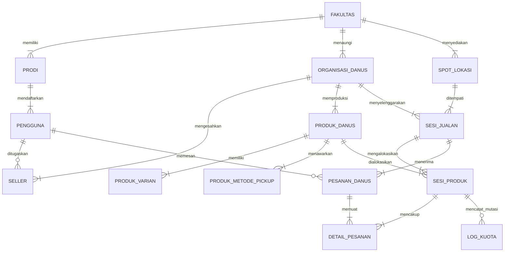

# BAB 1. PERANCANGAN KONSEPTUAL, ERD, DAN PEMBUKTIAN NORMALISASI

## 1.1 Deskripsi Domain Masalah dan Kebutuhan Bisnis DanusGo

Kegiatan pencarian dana usaha (danusan) mahasiswa merupakan aktivitas ekonomi mikro yang lazim di lingkungan kampus untuk mendanai kegiatan kepanitiaan, program kerja organisasi kemahasiswaan, maupun bakti sosial. Dalam praktiknya, pengelolaan danusan secara konvensional menghadapi sejumlah permasalahan operasional mendasar:
1. **Pencatatan Manual dan Kerentanan Stok (*Overselling*):** Pesanan umumnya dihimpun secara manual melalui aplikasi pesan instan atau formulir daring sederhana tanpa integrasi stok *real-time*. Pada produk *Pre-Order* dengan kapasitas produksi terbatas maupun makanan basah *Ready Stock*, penjual kerap menerima pesanan melebihi kuota fisik yang tersedia, berujung pada pembatalan sepihak dan kekecewaan pembeli.
2. **Konflik Alokasi Lokasi Stan Fisik (*Physical Spot Collision*):** Berbagai kelompok danusan sering kali berebut menempati titik-titik strategis kampus (seperti selasar gedung kuliah, gazebo fakultas, atau kantin) pada waktu yang bersamaan tanpa jadwal terkoordinasi, memicu ketidakteraturan antrean dan komplain dari pihak pengelola fasilitas kampus.
3. **Ketidakteraturan Variasi Produk dan Penyerahan Barang:** Satu jenis produk makanan sering kali memiliki varian rasa dan pilihan metode pengambilan (misal: ambil di stan vs diantar ke ruang kuliah). Pencatatan yang menyatukan opsi-opsi ini secara denormalisasi memicu redundansi pencatatan dan anomali pembaruan data.
4. **Disparitas Rekonsiliasi Kas:** Rekapitulasi keuangan antara pesanan yang lunas melalui QRIS dan pembayaran tunai (*Cash on Delivery* / COD) kerap menimbulkan selisih kas saat pembuatan Laporan Pertanggungjawaban (LPJ) kepanitiaan.

Platform **DanusGo** (*Campus Danusan & Food Tracking Hub*) dirancang sebagai solusi basis data terpusat berbasis PostgreSQL 16. Sistem ini mengintegrasikan seluruh siklus operasional danusan: mulai dari manajemen master akademik, pembukaan sesi jualan berbasis spot fisik dengan pencegahan tabrakan jadwal (*Exclusion Constraint*), kontrol pemesanan atomik anti-*overselling*, pemantauan status pesanan secara *real-time*, hingga agregasi keuangan seller.

---

## 1.2 Model Data Konseptual dan Entity-Relationship Diagram (ERD)

Arsitektur data DanusGo memadukan entitas akademik institusional dengan entitas transaksional e-commerce kampus. Secara konseptual, entitas dan relasi utama diklasifikasikan ke dalam empat domain utama:


*Gambar 1.1 Diagram Relasi Konseptual (Crow's Foot Notation) DanusGo.*

### Penjelasan Domain Relasional:
1. **Domain Master Akademik:**
   - `fakultas`: Entitas induk akademik (termasuk kategori 'Area Umum' untuk fasilitas rektorat/perpustakaan).
   - `prodi`: Entitas program studi yang berada di bawah naungan suatu fakultas ($1:N$).
2. **Domain Pengguna & Otorisasi:**
   - `pengguna`: Mahasiswa kampus yang terdaftar dengan NIM dan email unik. Pengguna memiliki peran tunggal (`BUYER`, `SELLER`, `ADMIN`).
   - `organisasi_danus`: Badan kemahasiswaan atau kepanitiaan yang memiliki rekening tujuan penampungan kas dan terikat pada fakultas induk.
   - `seller`: Entitas asosiasi ($M:N$) yang menghubungkan pengguna dengan peran `SELLER` ke organisasi danus tertentu.
3. **Domain Katalog Produk & Sesi Operasional:**
   - `spot_lokasi`: Titik fisik penjualan di kampus yang berada di bawah naungan fakultas.
   - `produk_danus`: Katalog barang yang diproduksi organisasi, diklasifikasikan ke dalam kategori `MAKANAN_BERAT`, `SNACK`, `MINUMAN`, atau `MERCHANDISE`.
   - `sesi_jualan`: Jadwal stan penjualan fisik yang mengikat organisasi, spot lokasi, tanggal jualan, serta rentang jam buka dan tutup.
   - `sesi_produk`: Alokasi kuota produk tertentu pada sesi jualan tertentu ($M:N$ antara `sesi_jualan` dan `produk_danus`).
4. **Domain Transaksional:**
   - `pesanan_danus`: Header transaksi pemesanan yang mencatat pembeli, sesi, metode bayar, kode pengambilan, dan status pesanan. Tabel ini dipartisi bulanan berbasis *Range Partitioning*.
   - `detail_pesanan`: Rincian item pesanan yang mereferensikan alokasi kuota sesi produk, varian, dan metode pickup.
   - `log_kuota`: Buku besar audit pencatatan mutasi sisa kuota (pengurangan saat pesan, pengembalian saat batal).

---

## 1.3 Kamus Data Entitas Utama

Berikut adalah kamus data ringkas dari entitas inti sistem DanusGo:

*Tabel 1.1 Kamus Data Entitas Utama Basis Data DanusGo.*

| Nama Entitas | Kolom Utama (Kunci) | Tipe Data | Batasan / Constraint | Keterangan Fungsional |
| :--- | :--- | :--- | :--- | :--- |
| `fakultas` | `id_fakultas` (PK) | INT IDENTITY | NOT NULL, UNIQUE(nama_fakultas) | Master fakultas kampus |
| `prodi` | `id_prodi` (PK)<br>`id_fakultas` (FK) | INT IDENTITY<br>INT | NOT NULL, REFERENCES fakultas<br>UNIQUE(id_fakultas, nama_prodi) | Program studi mahasiswa |
| `pengguna` | `id_mahasiswa` (PK)<br>`id_prodi` (FK) | INT IDENTITY<br>INT | UNIQUE(nim), UNIQUE(email)<br>CHECK (role IN ('BUYER','SELLER','ADMIN')) | Akun pengguna sistem |
| `organisasi_danus`| `id_organisasi` (PK)<br>`id_fakultas_induk` (FK) | INT IDENTITY<br>INT | NOT NULL, REFERENCES fakultas | Wadah kepanitiaan danus |
| `spot_lokasi` | `id_spot` (PK)<br>`id_fakultas` (FK) | INT IDENTITY<br>INT | UNIQUE(id_fakultas, nama_spot) | Titik stan fisik di kampus |
| `produk_danus` | `id_produk` (PK)<br>`id_organisasi` (FK) | INT IDENTITY<br>INT | CHECK (harga_jual >= harga_modal)<br>CHECK (kategori IN ('MAKANAN_BERAT',...)) | Master katalog produk |
| `produk_varian`| `id_varian` (PK)<br>`id_produk` (FK) | INT IDENTITY<br>INT | UNIQUE(id_produk, nama_varian)<br>ON DELETE CASCADE | Opsi varian rasa (4NF) |
| `produk_metode_pickup` | `id_pickup` (PK)<br>`id_produk` (FK) | INT IDENTITY<br>INT | UNIQUE(id_produk, metode_pickup)<br>ON DELETE CASCADE | Opsi penyerahan barang (4NF) |
| `sesi_jualan` | `id_sesi` (PK)<br>`id_spot`, `id_organisasi` (FK) | INT IDENTITY<br>INT | CHECK (jam_selesai > jam_mulai)<br>EXCLUDE USING gist (tsrange) | Jadwal stan jualan fisik |
| `sesi_produk` | `id_sesi_produk` (PK)<br>`id_sesi`, `id_produk` (FK) | INT IDENTITY<br>INT | UNIQUE(id_sesi, id_produk)<br>CHECK (kuota_sisa BETWEEN 0 AND kuota_awal) | Alokasi kuota per sesi |
| `pesanan_danus`| `id_pesanan`, `waktu_pesan` (PK) | BIGINT IDENTITY<br>TIMESTAMPTZ | PARTITION BY RANGE (waktu_pesan)<br>CHECK (kedaluwarsa_pada > waktu_pesan) | Transaksi induk (bulanan) |
| `detail_pesanan` | `id_detail` (PK)<br>`id_pesanan`, `waktu_pesan` (FK) | BIGINT IDENTITY<br>BIGINT, TIMESTAMPTZ | REFERENCES pesanan_danus<br>REFERENCES sesi_produk | Item rincian barang dipesan |
| `log_kuota` | `id_log` (PK)<br>`id_sesi_produk` (FK) | BIGINT IDENTITY<br>INT | REFERENCES sesi_produk | Jejak mutasi kuota |

---

## 1.4 Pembuktian Dekomposisi Normalisasi: BCNF dan 4NF

Penerapan normalisasi dilakukan secara ketat untuk menjamin ketiadaan redundansi data dan mencegah anomali operasi basis data (*insert, update, delete anomaly*).

### 1.4.1 Pembuktian Dekomposisi Boyce-Codd Normal Form (BCNF)

Suatu skema relasi $R$ dikatakan berada dalam **Boyce-Codd Normal Form (BCNF)** jika untuk setiap Functional Dependency ($FD$) non-trivial $\alpha \rightarrow \beta$ yang berlaku pada $R$, determinan $\alpha$ merupakan **Superkey** dari $R$.

#### Kasus A: Eliminasi Ketergantungan Transitif Pengguna dan Fakultas
Pada perancangan awal yang belum ternormalisasi, atribut profil mahasiswa menampung informasi program studi dan fakultas sekaligus:
$$R_\text{pengguna\_denorm} = (\underline{\text{id\_mahasiswa}}, \text{nim}, \text{nama}, \text{email}, \text{id\_prodi}, \text{nama\_prodi}, \text{id\_fakultas}, \text{nama\_fakultas})$$

Himpunan ketergantungan fungsional yang berlaku:
1. $\text{id\_mahasiswa} \rightarrow \text{nim}, \text{nama}, \text{email}, \text{id\_prodi}$
2. $\text{id\_prodi} \rightarrow \text{nama\_prodi}, \text{id\_fakultas}$
3. $\text{id\_fakultas} \rightarrow \text{nama\_fakultas}$

*Evaluasi BCNF:*
Pada dependensi $\text{id\_prodi} \rightarrow \text{id\_fakultas}$, determinan $\text{id\_prodi}$ bukan candidate key maupun superkey dari $R_\text{pengguna\_denorm}$. Kondisi ini melanggar BCNF (dan 3NF, karena terjadi ketergantungan transitif $\text{id\_mahasiswa} \rightarrow \text{id\_prodi} \rightarrow \text{id\_fakultas}$). Dampaknya, jika ada 1.000 mahasiswa dari prodi Teknik Informatika, nama prodi dan fakultasnya akan ditulis ulang sebanyak 1.000 kali.

*Dekomposisi BCNF:*
Skema didekomposisi menjadi tiga relasi terpisah:
1. $R_1 (\text{fakultas}) = (\underline{\text{id\_fakultas}}, \text{nama\_fakultas})$  
   Determinan $\text{id\_fakultas}$ adalah Superkey (Primary Key). Relasi memenuhi BCNF.
2. $R_2 (\text{prodi}) = (\underline{\text{id\_prodi}}, \text{nama\_prodi}, \text{id\_fakultas})$  
   Determinan $\text{id\_prodi}$ adalah Superkey. Relasi memenuhi BCNF.
3. $R_3 (\text{pengguna}) = (\underline{\text{id\_mahasiswa}}, \text{nim}, \text{nama}, \text{email}, \text{id\_prodi}, \dots)$  
   Determinan $\text{id\_mahasiswa}$ dan $\text{nim}$ adalah Candidate Key (Superkey). Relasi memenuhi BCNF.

---

#### Kasus B: Desain Integritas Skema `detail_pesanan` (Peniadaan `id_sesi`)
Secara logika bisnis, setiap pesanan dan item detailnya terikat pada sesi jualan tertentu. Pertanyaan desain penting: *Apakah kolom `id_sesi` perlu disimpan di tabel `detail_pesanan`?*

Misalkan skema relasi dirancang memuat `id_sesi`:
$$R_\text{detail\_naif} = (\underline{\text{id\_detail}}, \text{id\_pesanan}, \text{id\_sesi\_produk}, \text{id\_sesi}, \text{jumlah\_item}, \text{harga\_satuan})$$

Pada domain sistem DanusGo, terdapat Functional Dependency yang pasti:
$$\text{id\_sesi\_produk} \rightarrow \text{id\_sesi}$$
Artinya, setiap entitas alokasi produk sesi (`id_sesi_produk`) secara deterministik mengindikasikan sesi jualan induknya (`id_sesi`).

*Evaluasi BCNF:*
Kunci utama dari $R_\text{detail\_naif}$ adalah $\text{id\_detail}$. Determinan $\text{id\_sesi\_produk}$ **bukanlah Superkey** dari tabel detail pesanan (karena satu alokasi produk sesi dapat dipesan oleh banyak pesanan berbeda). Oleh karena itu, keberadaan $FD: \text{id\_sesi\_produk} \rightarrow \text{id\_sesi}$ pada relasi ini secara tegas **melanggar aturan BCNF**.

*Konsekuensi Anomali jika `id_sesi` Disimpan:*
- **Redundansi:** Nilai `id_sesi` terduplikasi pada ribuan baris `detail_pesanan`.
- **Inkonsistensi Data (*Update Anomaly*):** Muncul risiko di mana `id_sesi` pada header pesanan berbeda dengan `id_sesi` pada detail pesanan (misal: pesanan tercatat di Sesi A, tetapi itemnya tercatat di Sesi B).

*Keputusan Desain dan Kompensasi Integritas:*
Atribut `id_sesi` **dieliminasi secara penuh** dari skema fisik `detail_pesanan`. Dengan demikian, relasi `detail_pesanan` memenuhi kaidah BCNF:
$$\text{detail\_pesanan} = (\underline{\text{id\_detail}}, \text{id\_pesanan}, \text{waktu\_pesan}, \text{id\_sesi\_produk}, \text{id\_varian}, \text{id\_pickup}, \text{jumlah\_item}, \dots)$$

Untuk menjamin bahwa item yang dipesan benar-benar milik sesi yang sama dengan pesanan induknya, integritas relasional tidak diserahkan pada denormalisasi kolom, melainkan ditegakkan secara absolut di tingkat basis data melalui trigger PL/pgSQL:

```sql
CREATE FUNCTION fn_validasi_detail() RETURNS trigger AS $$
DECLARE
  v_sesi_header INT;
  v_sesi_item   INT;
BEGIN
  SELECT id_sesi INTO v_sesi_header FROM pesanan_danus
   WHERE id_pesanan = NEW.id_pesanan AND waktu_pesan = NEW.waktu_pesan;
  SELECT id_sesi INTO v_sesi_item FROM sesi_produk
   WHERE id_sesi_produk = NEW.id_sesi_produk;

  IF v_sesi_header IS DISTINCT FROM v_sesi_item THEN
    RAISE EXCEPTION 'Pelanggaran BCNF Integritas: Item sesi_produk % (Sesi %) tidak sesuai dengan pesanan header (Sesi %)',
      NEW.id_sesi_produk, v_sesi_item, v_sesi_header;
  END IF;
  RETURN NEW;
END $$ LANGUAGE plpgsql;
```

---

### 1.4.2 Pembuktian Dekomposisi Fourth Normal Form (4NF)

Normalisasi tingkat empat (**4NF**) bertujuan mengeliminasi **Multivalued Dependency (MVD)** independen yang bercampur dalam satu skema relasi.

#### Definisi MVD:
Diberikan relasi $R(X, Y, Z)$. Berlaku Multivalued Dependency $X \twoheadrightarrow Y$ jika himpunan nilai $Y$ yang diasosiasikan dengan pasangan nilai $(X, Z)$ tertentu hanya bergantung pada nilai $X$ semata, dan sepenuhnya independen dari nilai $Z$.

#### Studi Kasus Anomali Produk Danus:
Setiap produk danusan (misalkan `id_produk = 10`, "Risoles Mayo Beef Keju") memiliki:
- Opsi varian rasa ($Y$): `Original`, `Pedas`, `Keju` ($|Y| = 3$).
- Opsi metode pengambilan ($Z$): `Ambil di Stan`, `Diantar ke Kelas` ($|Z| = 2$).

Karakteristik penting: Pilihan varian rasa tidak memiliki kaitan logis apa pun dengan metode bagaimana makanan tersebut diambil. Keduanya merupakan atribut bernilai jamak (*multivalued attributes*) yang independen.

#### Bentuk Relasi Non-4NF dan Anomali Redundansi:
Jika kedua atribut digabungkan dalam satu skema relasi $R_\text{opsi\_produk}$:
$$R_\text{opsi\_produk} = (\underline{\text{id\_produk}}, \underline{\text{nama\_varian}}, \underline{\text{metode\_pickup}})$$

Karena tidak ada dependensi fungsional yang mengikat varian ke pickup, kunci utama dari relasi ini adalah seluruh atribut secara komposit $(\text{id\_produk}, \text{nama\_varian}, \text{metode\_pickup})$.

*Tabel 1.2 Anomali Perkalian Kartesian pada Relasi Non-4NF.*

| id_produk | nama_varian ($Y$) | metode_pickup ($Z$) | Keterangan Anomali |
| :---: | :--- | :--- | :--- |
| `10` | Original | Ambil di Stan | Kombinasi 1 |
| `10` | Original | Diantar ke Kelas | Kombinasi 2 (Redundansi metode pickup) |
| `10` | Pedas | Ambil di Stan | Kombinasi 3 (Redundansi nama varian) |
| `10` | Pedas | Diantar ke Kelas | Kombinasi 4 (Redundansi nama varian) |
| `10` | Keju | Ambil di Stan | Kombinasi 5 (Redundansi nama varian) |
| `10` | Keju | Diantar ke Kelas | Kombinasi 6 (Redundansi nama varian) |

*Anomali yang Ditimbulkan:*
1. **Redundansi Perkalian Kartesian ($M \times N$):** Untuk 3 varian rasa dan 2 metode pickup, tabel harus menyimpan $3 \times 2 = 6$ baris data. Jika suatu produk memiliki 5 varian dan 4 metode pickup, akan tercipta 20 baris redundan.
2. **Anomali Penyisipan (*Insertion Anomaly*):** Jika penjual ingin menambahkan varian baru (`Blackpepper`), sistem terpaksa menyisipkan 2 baris baru untuk setiap metode pickup yang tersedia. Jika metode pickup belum ditentukan, varian tidak dapat dicatat tanpa memasukkan nilai `NULL` pada primary key (melanggar *Entity Integrity Constraint*).
3. **Anomali Pembaruan (*Update Anomaly*):** Jika istilah metode pickup `Diantar ke Kelas` diubah menjadi `Diantar ke Gedung Kuliah`, pembaruan harus dilakukan pada 3 baris sekaligus. Kelalaian memperbarui salah satu baris akan menghasilkan data yang tidak konsisten.
4. **Anomali Penghapusan (*Deletion Anomaly*):** Jika suatu metode pickup dihentikan sementara, menghapus baris-baris tersebut berisiko menghapus informasi varian rasa jika tidak terdapat kombinasi lain.

#### Formalisasi MVD:
Pada relasi $R_\text{opsi\_produk}$ berlaku:
$$\text{id\_produk} \twoheadrightarrow \text{nama\_varian} \quad \text{dan} \quad \text{id\_produk} \twoheadrightarrow \text{metode\_pickup}$$
di mana $\text{nama\_varian} \cap \text{metode\_pickup} = \emptyset$.

Karena determinan $\text{id\_produk}$ **bukanlah Superkey** dari relasi gabungan $R_\text{opsi\_produk}$, skema ini **melanggar 4NF**.

---

#### Dekomposisi Relasi ke 4NF:
Sesuai teorema dekomposisi Fagin, skema didekomposisi menjadi dua relasi terpisah:
1. Skema Varian Produk ($R_1$):
   $$\text{produk\_varian} = (\underline{\text{id\_produk}}, \underline{\text{nama\_varian}})$$
   Primary Key: $(\text{id\_produk}, \text{nama\_varian})$.  
   MVD yang berlaku: $\text{id\_produk} \twoheadrightarrow \text{nama\_varian}$. Karena dalam $R_1$ atribut tersisa hanyalah $\text{nama\_varian}$, dependensi ini berstatus trivial. Relasi memenuhi **4NF**.
2. Skema Metode Pickup Produk ($R_2$):
   $$\text{produk\_metode\_pickup} = (\underline{\text{id\_produk}}, \underline{\text{metode\_pickup}})$$
   Primary Key: $(\text{id\_produk}, \text{metode\_pickup})$.  
   MVD yang berlaku: $\text{id\_produk} \twoheadrightarrow \text{metode\_pickup}$, yang berstatus trivial dalam $R_2$. Relasi memenuhi **4NF**.

#### Pembuktian Lossless-Join Decomposition:
Dekomposisi $R$ menjadi $R_1$ dan $R_2$ dijamin bersifat *Lossless-Join* jika dan hanya jika:
$$R_1 \cap R_2 \twoheadrightarrow R_1 \quad \text{atau} \quad R_1 \cap R_2 \twoheadrightarrow R_2$$
Dalam kasus ini:
$$R_1 \cap R_2 = \{\text{id\_produk}\}$$
Karena pada relasi induk berlaku $\text{id\_produk} \twoheadrightarrow \text{nama\_varian}$ (yang membentuk $R_1$) dan $\text{id\_produk}$ merupakan Primary Key (Superkey) pada tabel katalog `produk_danus`, maka operasi *Natural Join* ($R_1 \bowtie R_2$) dijamin merekonstruksi relasi awal secara tepat tanpa memunculkan tuple palsu (*spurious tuples*).

#### Pembuktian Dependency Preservation:
Seluruh dependensi nilai jamak awal sepenuhnya terpelihara pada relasi $R_1$ dan $R_2$ masing-masing tanpa memerlukan operasi join antar tabel untuk memvalidasi batasannya.

---

## 1.5 Kesimpulan Bab 1

Perancangan skema konseptual dan logikal basis data DanusGo telah berhasil memenuhi kualifikasi normalisasi tingkat tinggi:
1. **BCNF Tercapai:** Seluruh dependensi transitif dieliminasi, dan peniadaan atribut redundan `id_sesi` pada tabel `detail_pesanan` terbukti menjaga derajat BCNF secara murni dengan pengawalan integritas via trigger basis data.
2. **4NF Tercapai:** Dekomposisi relasi produk varian dan metode pickup berhasil melenyapkan anomali perkalian kartesian MVD, memangkas ruang penyimpanan, serta menjamin integritas operasi *lossless join*.
3. Skema logikal ini menjadi fondasi yang kokoh bagi implementasi DDL fisik PostgreSQL dan pengujian performa transaksi pada bab-bab selanjutnya.
